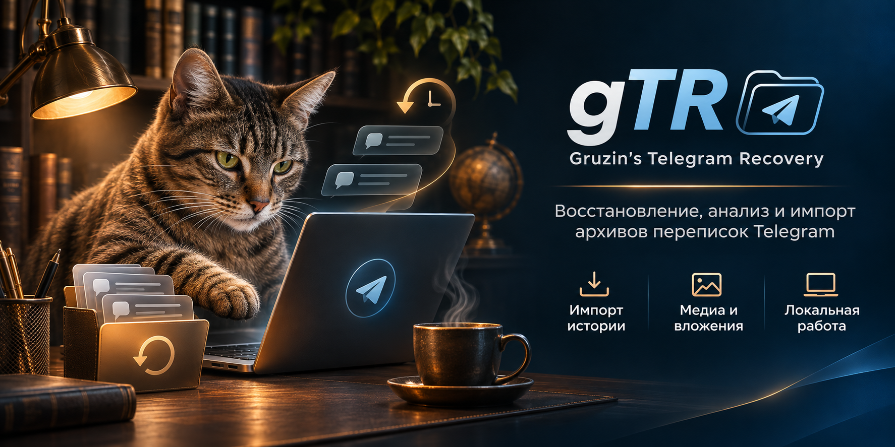

# gTR

**Beta 6 · Грузин (Gruzin) · Windows 10/11 x64**

gTR — неофициальное приложение, которое использует Telegram API. Оно открывает экспорты Telegram Desktop, сохраняет доступную историю и вложения в отдельном проекте, готовит пакеты History Import и сверяет результат. Просмотр, подготовка и имитация работают без подключения к Telegram.

## Запуск

Распакуйте **gTR-Beta-6-Windows-x64.zip** в локальную папку. Откройте **gTR.exe** или **gTR.cmd**. В комплект входят оболочка Qt на C++ и прежний интерфейс на Python. Команда **gTR.cmd classic** открывает прежнее окно, если Windows блокирует неподписанный EXE. [Ограничения](KNOWN_LIMITATIONS.md)

При запуске из исходников выполните **setup.cmd** с CPython 3.14.10 x64. Для сборки нативной оболочки нужны CMake, MSVC и Qt Multimedia. [Сборка](docs/BUILD.md) · [Обновление](UPGRADE.md)

## Подключение и обновление

Архивы, профили и история операций хранятся на компьютере пользователя. Просмотр экспорта и подготовка пакета доступны сразу. Для подключения напрямую к Telegram приложение использует API ID и API hash владельца этой установки. Windows может сохранить их по вашему выбору. После входа в разделе «Telegram» доступна карточка аккаунта. [Подключение](docs/OWNER.md#подключение-telegram)

Переносимый gTR увидит ZIP более свежего выпуска в «Загрузках». Нажмите «Найдена Beta …» или выберите скачанный файл через **Настройки → Обновление gTR**. После подтверждения gTR сверит ZIP с официальным выпуском GitHub, установит версию отдельно и перезапустится с вашими проектами и настройками. [Обновление](UPGRADE.md)

## Лицензия и авторство

Автор исходного gTR — **Грузин (Gruzin)**. Исходники можно изучать, форкать, изменять и распространять по Apache 2.0 с сохранением лицензии и уведомлений об авторстве. Для своей сборки, использующей Telegram API, зарегистрируйте отдельное приложение Telegram. Если вы публикуете изменённую сборку, укажите её происхождение и свои изменения. [Лицензия](LICENSE) · [Авторство](NOTICE) · [Названия и логотип](TRADEMARKS.md) · [Сторонние компоненты](THIRD_PARTY.md)

## Продолжение импорта

В разделе «Восстановление» выберите источник и диалог, проверьте план и подготовьте пакет. Для входа и отправки используйте кнопку «Открыть серверный импорт…» на экране результата. Прежний интерфейс поддерживает сохранённые профили, продолжение импорта, защиту от повторов и сверку. [Руководство владельца](docs/OWNER.md)

## Локальная работа

Инструкция открывается в настройках. [Экспорт из Telegram Desktop и загрузка в gTR](gtr/assets/export-guide.md)

1. Откройте ZIP, RAR, HTML, JSON или папку экспорта в «Архиве». Автоматический режим предпочитает JSON, если доступны оба формата.
2. Выберите диалог и запись. Доступны поиск, более ранние записи, исторические даты, сведения о пересылках и локальный предпросмотр поддерживаемых вложений.
3. Откройте «Восстановление» и проверьте план. Для профилей видео, режима вложений и подписей пересылок включите расширенный режим.
4. В «Истории» можно сверить пакет с локальными снимками. Отчёты по датам, резервные копии, имитация и дополнительные фильтры доступны в прежнем интерфейсе.

## Режимы

| Режим | Что входит |
|---|---|
| Только текст | Тексты и доступные подписи. Файлы вложений не читаются при подготовке и проверке. |
| Полная история | Поддерживаемый текст и медиа, проверка структуры и SHA-256. Для выбранного пакета можно явно передать медиа как документы. |
| Контрольный тест | Отдельный пакет на 2, 10 или 100 вымышленных записей. Для теста медиа добавляется синтетическое изображение. |

Исторические имена, исходные даты и смещения остаются в локальных данных. Telegram сам определяет серверного отправителя, направление и отображение. Журнал разделяет подготовку, загрузку, принятие запуска и независимую сверку. [Руководство и испытания на двух аккаунтах](docs/OWNER.md) · [Безопасный импорт и восстановление](docs/SAFE_IMPORT.md)

Если часть выбранной истории связана с предыдущей операцией, gTR показывает совпавшие записи и причину блокировки. Для доступных записей можно подготовить отдельный пакет. При неизвестном результате запуска сначала нужна сверка прежней операции. [Восстановление операций](docs/SAFE_IMPORT.md)

Если для видео нужно решение, откроется окно «Совместимость медиафайлов». Выберите «Подготовить все совместимые копии и продолжить», чтобы обработать подходящие видео за один проход. Настройка «Автоматически подготавливать совместимые видео» заранее разрешает создание копий. Совместимые оригиналы используются побайтно. Доступные метаданные проверяются через локальные FFmpeg и FFprobe. «Верификация → Результаты восстановления» показывает исходный, пакетный и полученный тип. [Видео и другие медиа](docs/MEDIA_RECOVERY.md) · [Точность восстановления](docs/VERIFICATION.md)

## Командная строка

~~~powershell
.\gTR.cmd analyze "C:\Exports\Conversation.zip" --project "C:\Recovery\Project"
.\gTR.cmd plan "C:\Recovery\Project" --chat 1 --first-record 1 --last-record 10
.\gTR.cmd prepare "C:\Recovery\Project" --chat 1 --first-record 1 --last-record 10 --media-mode text_only --out "C:\Recovery\Package"
.\gTR.cmd prepare "C:\Recovery\Project" --chat 1 --auto-compatible-videos --out "C:\Recovery\MediaPackage"
.\gTR.cmd media-check "C:\Recovery\Project" --project --chat 1
.\gTR.cmd simulate "C:\Recovery\Package" --project "C:\Recovery\Project"
.\gTR.cmd fixture --size 10 --scenario media --out "C:\Recovery\Synthetic"
.\gTR.cmd fidelity "C:\Recovery\Package" --out "C:\Recovery\Fidelity.json"
.\gTR.cmd operations
~~~

У отчётов о медиа, серверной операции и сверке есть обезличенный вариант. Отчёты проекта, файлы экспорта, пакеты и частные снимки содержат личные данные. Сохранённая сессия Telegram защищена Windows DPAPI.

## Материалы выпуска

- [Изменения версий](CHANGELOG.md)
- [Результаты проверок](TEST_REPORT.md)
- [Ограничения](KNOWN_LIMITATIONS.md)
- [Гибридная архитектура](docs/HYBRID_ARCHITECTURE.md) и [протокол IPC](docs/IPC_PROTOCOL.md)
- [Медиадвижок](docs/MEDIA_ENGINE.md) и [привязка вложений](docs/ATTACHMENT_BINDING.md)
- [Сборка и подпись Windows](docs/BUILD.md)

- [Движок восстановления](docs/RECOVERY_ENGINE.md)
- [Возможности History Import](docs/API_LIMITATIONS.md)
- [Безопасность](SECURITY.md) и [конфиденциальность](PRIVACY.md)
